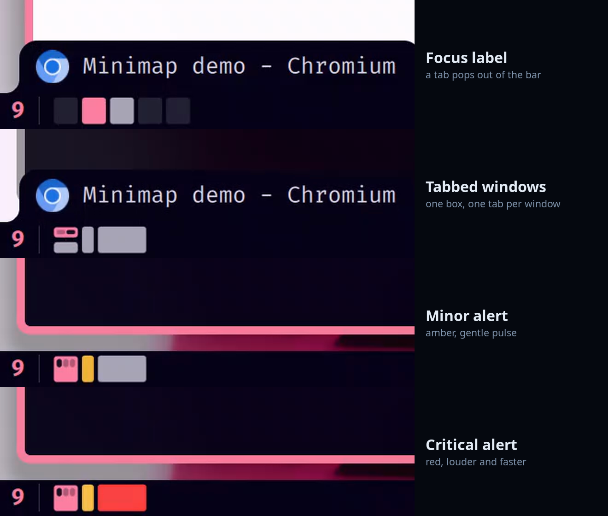
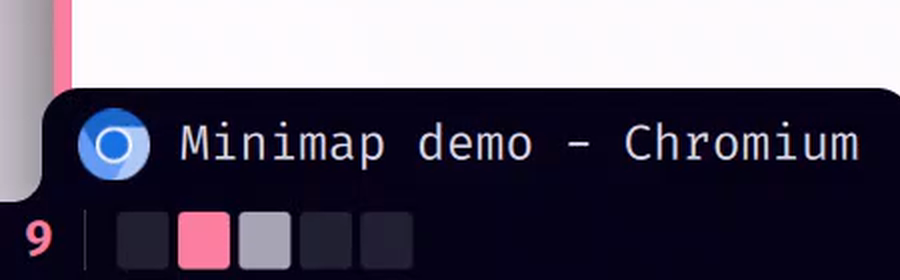
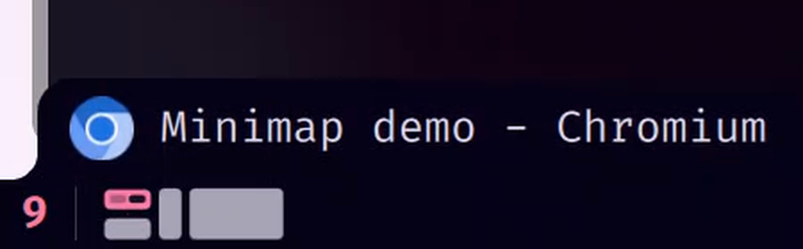
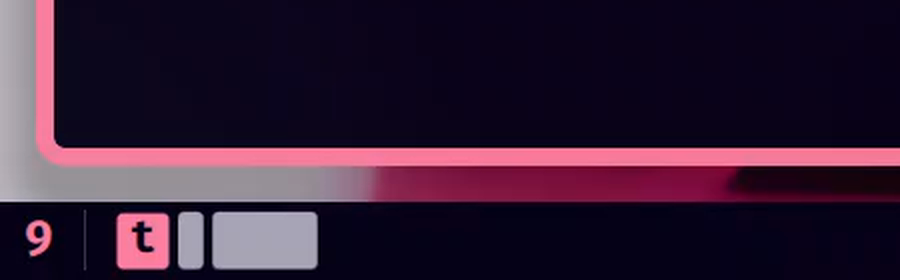
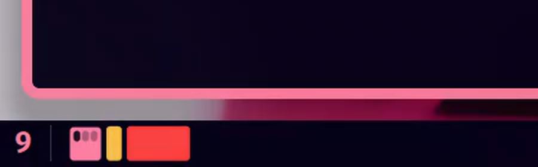
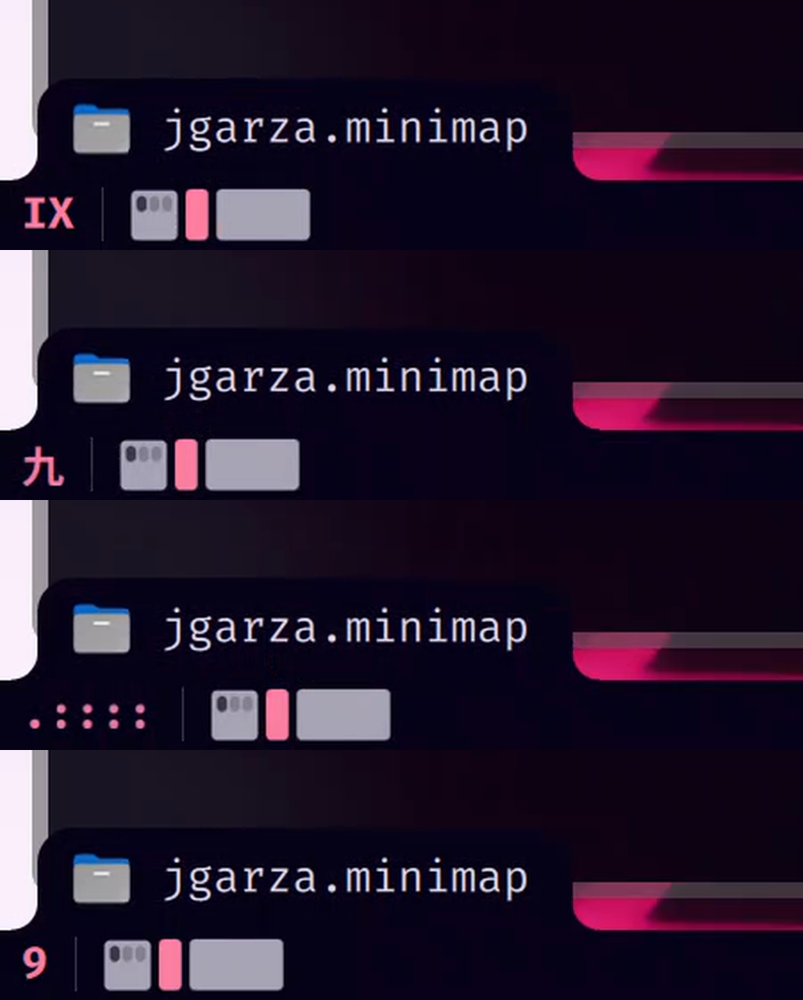
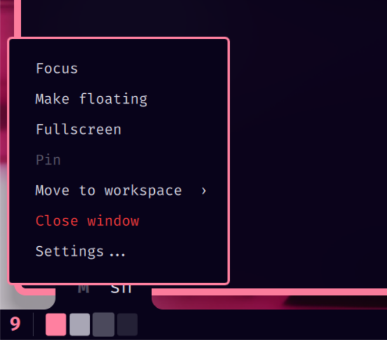
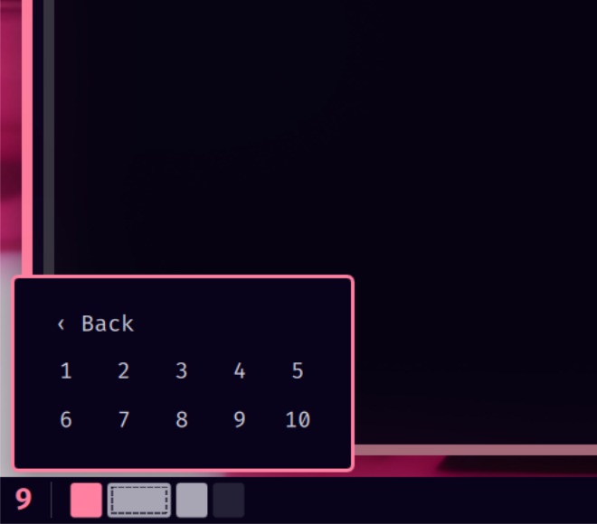
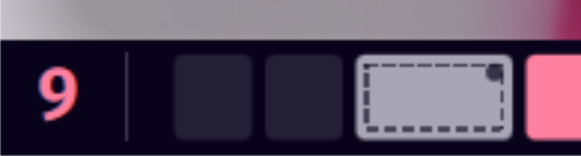
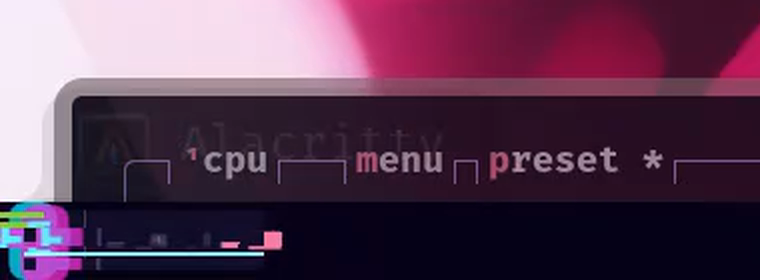

# Minimap

An Omarchy bar widget that draws your **workspace number**, a **separator**, and a row of
**boxes - one per window** - laid out like the Hyprland scrolling layout you are actually using.



**[▶ Watch the demo on YouTube](https://youtu.be/apKp1ZKx6ek)** - every feature in under three minutes.

Every box keeps its window's exact proportions (a square window is a square box), moves on
springs when windows open, close or resize, and names itself in a little tab when you focus or
hover it. It also tells you when a window wants your attention: **amber** for minor alerts,
**red** for critical ones.

## Highlights

| | |
|---|---|
|  | **Focus label.** Hover a box or change focus and a tab pops out of the bar with the app icon and window title. It glides and stretches between boxes. |
|  | **Stacked windows** keep their own slice of a box, with a gap between them. |
|  | **Tabbed (grouped) windows** become one box with a tab per window; click a tab to jump to it. Or pick a plain **t** in the box . |
|  | **Minor alerts** (urgent windows, low/normal notifications) turn the box amber and pulse a soft glow. |
|  | **Critical alerts** turn it red, louder and faster. Focus the window and the alert clears with a little flourish. |
|  | **Alert on another workspace?** The workspace number lights up so you know where to look. |
|  | **Number styles:** `9`, `IX`, `九`, `.::::` |
|  | **Box menu** (opt-in): right-click a box for focus, float, fullscreen, pin, move to workspace, close. |
|  | **Move to workspace** from the same menu - pick 1-10. |
|  | **State markers:** a dashed outline for floating windows, a dot for pinned, corner brackets for fullscreen. |

## Install

```bash
omarchy plugin enable jgarza.minimap
```

Add it to the bar in `~/.config/omarchy/shell.json`:

```jsonc
{ "bar": { "layout": { "center": [ { "id": "jgarza.minimap" } ] } } }
```

It works best with `layout = "scrolling"` (boxes follow the real column order), but any layout
draws a sensible map. Needs `python3` and either `busctl` (systemd) or `inotifywait`
(inotify-tools) for notification alerts; everything else is built in.

## Using it

| | |
|---|---|
| **Left-click** a box or tab | focus that window |
| **Scroll** over the widget | previous / next workspace |
| **Click the number** | jump to whatever is alerting (critical first, then the newest) |
| **Right-click** | settings (or the box menu when *Box actions* is on) |
| **Middle-click** a box | close that window (*Box actions* on) |
| **Right-drag** a box | move its column left or right (*Drag to reorder* on) |

*Box actions* and *Drag to reorder* are off by default, because they close and rearrange your
windows. Switch them on in the right-click settings. With *Box actions* on, the settings move to
a right-click on the number or separator (and there is a "Settings..." row in the box menu).

> Why the **right** button for dragging? Omarchy's bar uses a left-drag on any widget to move that
> widget around the bar, so a left-drag never reaches the boxes. Left-*clicks* do, and the right
> button is free.

## Settings

All of these are in the right-click popup and in the plugin's settings schema; in `shell.json`
they are keys on the widget entry.

| Key | Values | Default | |
|---|---|---|---|
| `numberStyle` | `numbers` `roman` `japanese` `dots` | `numbers` | how the workspace number is written |
| `groupStyle` | `tabbar` `letter` | `tabbar` | how a tabbed window looks |
| `animStyle` | `smooth` `cyberpunk` `fun` `magic` `ripple` | `smooth` | motion and effects (below) |
| `attention` | `true` `false` | `true` | alert cues for urgent windows and notifications |
| `showFloating` | `true` `false` | `false` | include floating windows in the map |
| `stateMarkers` | `true` `false` | `true` | marks for fullscreen / pinned / floating windows |
| `boxActions` | `true` `false` | `false` | right-click box menu and middle-click close |
| `dragReorder` | `true` `false` | `false` | right-drag a box to reorder its column |
| `maxWidth` | 60-600 | `200` | longest the box row may get (px); everything shrinks together past it |
| `gap` | 0-12 | `3` | space between boxes (px) |

## Animation styles

Every style changes the spring feel, what happens when a window opens, gains focus or closes,
the workspace-number swap, **the effect when you switch workspace**, and how alerts look.

| Style | Feel | Workspace switch |
|---|---|---|
| **smooth** (default) | calm springs, soft fades, a gentle glow | the widget dips and recovers |
| **cyberpunk** | glitches, RGB split, hard flickers | **screen tearing** - slices of the widget jump sideways - and the number **decodes** out of glyph noise |
| **fun** | big bouncy pops, wobble, shockwave rings | the widget squashes and bounces back |
| **magic** | sparkles and a shimmering sweep | a shimmer crosses the widget, sparkles fly |
| **ripple** | Android-style ink ripples | a ripple spreads from the number |



## Alerts

A box lights up when:

- Hyprland reports the window **urgent** (a terminal bell, a chat app asking for you), or
- a **desktop notification** arrives from that app.

**Minor** = urgent window or low/normal notification: amber. **Critical** = critical
notification: red. The colours are fixed on purpose - some themes' "urgent" colour is nearly
their accent, and a critical alert must never look like the focused box. The cue stays until you
focus the window (any tab of a group counts). Alerts on a window in another workspace light up
the workspace number instead.

### Which window sent it?

`bin/notify-watch` watches the session bus (`org.freedesktop.Notifications.Notify`), so it
works with **any** notification daemon - Omarchy's shell, mako, dunst, swaync, KDE. If the bus
cannot be monitored it falls back to Omarchy's own notification files via `inotifywait`.

The sender's process (and its parent chain) picks the exact window - a script's alert lights the
terminal it runs in. Otherwise the app name, icon and desktop-entry are matched against window
classes, and when several windows match, the most recently used one wins.

Try it:

```bash
notify-send -a chromium -u normal   "Build finished" "all tests passed"   # amber
notify-send -a chromium -u critical "Deploy failed"  "check the logs"      # red
```

## Scripting

The widget answers `omarchy-shell minimap <function>`:

```bash
omarchy-shell minimap alert chromium critical   # light the chromium window red (minor | critical)
omarchy-shell minimap clear                     # drop every alert
omarchy-shell minimap jump                      # focus the most urgent alert
omarchy-shell minimap list                      # the boxes as JSON
```

`alert` takes an app name, matched against window classes like a notification would be. For
testing without a pointer there are also `menu <row>`, `action <id> <row> [arg]` (`focus`, `float`,
`fullscreen`, `pin`, `ungroup`, `moveto`, `close`) and `reorder <from> <to>`. The destructive ones
only work while *Box actions* / *Drag to reorder* are switched on.

## Files

| | |
|---|---|
| `BarWidget.qml` | the widget: layout, boxes, label tab, alerts, settings popup |
| `BoxFx.qml` | per-box effects (glow, glitch, rings, sparkles, ripple) |
| `StateMarks.qml` | fullscreen / pinned / floating marks inside a box |
| `WorkspaceFx.qml` | workspace-switch effects (tearing, bounce, shimmer, ripple) |
| `Model.js` | pure logic (geometry, grouping, alerts, settings) - unit tested with node |
| `bin/notify-watch` | notification stream for any daemon |
| `tests/` | `model.test.js`, `attention.test.js`, `test_notify_watch.py` |

## Tests

```bash
node tests/model.test.js
node tests/attention.test.js
python3 -I tests/test_notify_watch.py   # includes live D-Bus and inotifywait runs
```

If you edit the QML and nothing changes, clear Quickshell's cache:
`rm -rf ~/.cache/quickshell/qmlcache/* && omarchy restart shell`.

## Safety notes

- Text from other programs (window titles) is always drawn as plain text, never parsed as markup.
- `bin/notify-watch` forwards only app/icon names, urgency and process ids - never a
  notification's summary or body. Output is rate limited (20/s), strings are clipped, files are
  read size-capped and symlinks/FIFOs are refused. It exits with its parent and takes its child
  processes with it; the widget restarts it (2 s, backing off to 30 s) if it dies.
- Sender pid: the bus's own answer when available. If the sender already exited (notify-send),
  the client's `sender-pid` hint is used only if it is a live process of the same user (never
  pid 1 or other users' pids). A same-user program can still name one of its own processes -
  that is only a cosmetic cue.

## License

MIT
